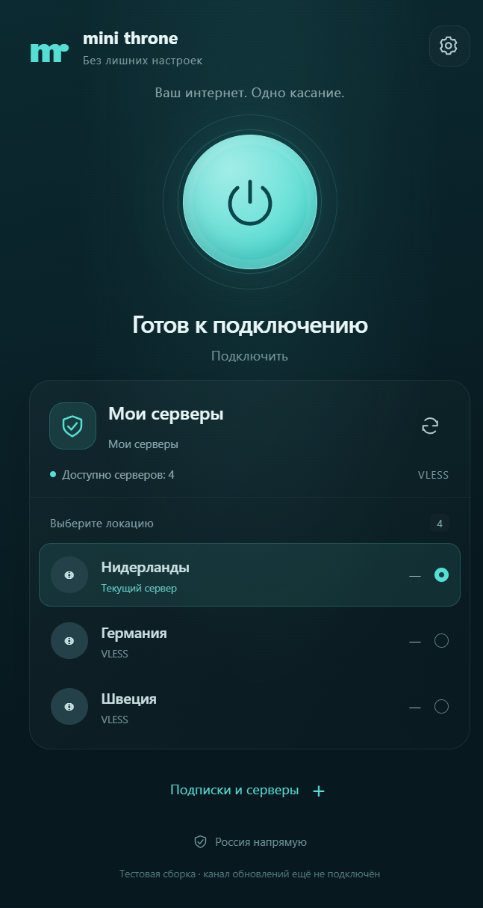

# Mini Throne

Простой Windows-клиент для совместимых инстансов Minishop, на основе Throne.
**0.1.0-alpha.4 — тестовая сборка**, не массовый релиз.

Работает и без Minishop: добавляйте обычные ссылки подписок и отдельные серверы
через «Добавить подписку или сервер». Подписки обновляются, источники и выбранный
источник сохраняются после перезапуска.

Системный прокси и TUN доступны только в настройках по шестерёнке. По умолчанию
включён системный прокси; TUN требует прав администратора. Режимы взаимно исключаются.

- [Исследование, решения и ограничения](docs/research-and-first-iteration.md)
- [Установка клиента и ZIP-плагина](docs/installation.md)
- [Проверки первой сборки](docs/validation.md)
- [Исходная документация Throne](README.upstream.md)

В `desktop/` — React/Electron-интерфейс и адаптер к официальному движку 1.4.1.
В `minishop-plugin/` — авторизация устройства, оформление, подписка и персональные
EXE с одноразовым билетом в имени, без серверной сборки и архива. Остальной исходный код сохраняется
для соответствия GPL-3.0 и последующих обновлений upstream.

Постоянные пароли, токены репозиториев и ссылки подписки в установщик не встраиваются.
EXE этой alpha ещё не имеет Authenticode; автоматический канал обновлений отключён
до настройки подписи и сервера. Плагин имеет отдельную проверяемую Ed25519-подпись.
