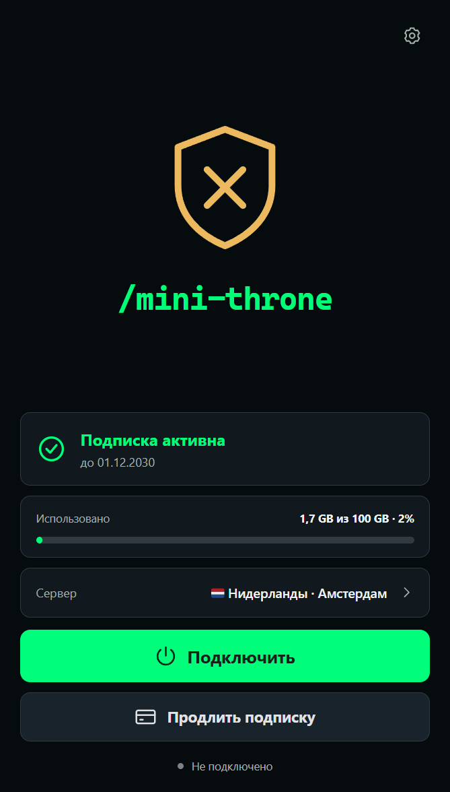
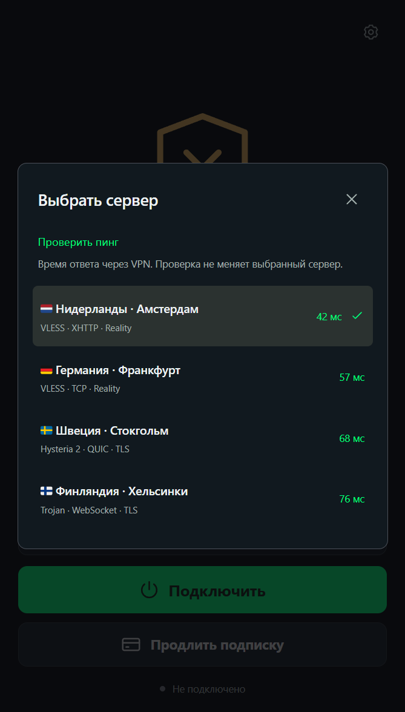

# Mini Throne

Простой Windows-клиент для совместимых инстансов Minishop, на основе Throne.
**0.1.7 — публичная версия для тестирования.**

[Скачать EXE для Windows](https://github.com/3252a8/mini-throne/releases/latest/download/Mini-Throne-Setup-x64.exe) · [Релизы и плагин](https://github.com/3252a8/mini-throne/releases/latest)

Работает и без Minishop: добавляйте обычные ссылки подписок и отдельные серверы
через «Добавить подписку или сервер». Подписки обновляются, источники и выбранный
источник сохраняются после перезапуска.

Главная страница содержит только подключение, сервер и подписку. Системный прокси
и TUN доступны в настройках по шестерёнке; кнопка «Полные настройки Throne»
открывает штатный интерфейс с той же базой профилей. По умолчанию
включён системный прокси; TUN требует прав администратора. Режимы взаимно исключаются.

  
  

На скриншотах — вымышленные серверы и данные подписки. Название и щит стандартные;
после входа совместимый сервис может передать своё оформление и анимированный WebP-логотип.

- [Макет и решения интерфейса](docs/design-alpha5.md)
- [Исследование, решения и ограничения](docs/research-and-first-iteration.md)
- [Установка клиента и ZIP-плагина](docs/installation.md)
- [Проверки первой сборки](docs/validation.md)
- [Исходная документация Throne](README.upstream.md)

В `desktop/` — React/Electron-интерфейс и адаптер к официальному движку 1.4.1.
В `minishop-plugin/` — авторизация устройства, оформление, подписка и персональные
EXE с одноразовым билетом в имени, без серверной сборки и архива. Остальной исходный код сохраняется
для соответствия GPL-3.0 и последующих обновлений upstream.

Постоянные пароли, токены репозиториев и ссылки подписки в установщик не встраиваются.
Обновления приложения и выдача установщика плагином используют публичные GitHub Releases
с проверкой Ed25519-подписи и хеша файла. GitHub Actions собирает EXE и подписанный ZIP
плагина, публикует релиз и обновляет индекс установки по ссылке на этот репозиторий.
Сервер Minishop ничего не собирает. Windows EXE пока без Authenticode: SmartScreen может
показывать предупреждение о неизвестном издателе. Подпись обновлений проверяется самим клиентом.

Подробности: [установка и обновления](docs/installation.md), [безопасность релизов](docs/release-security.md).
