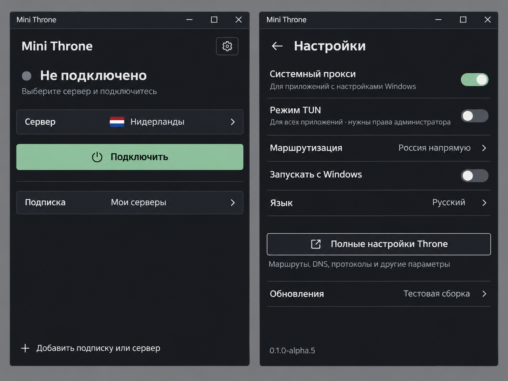
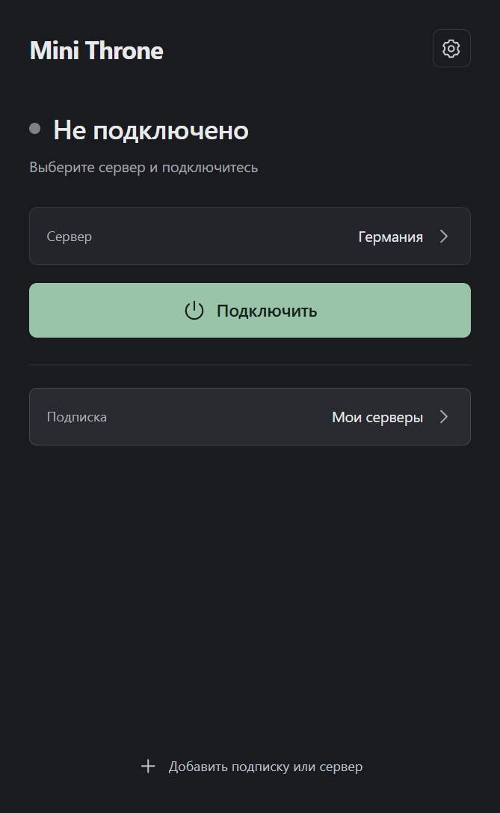
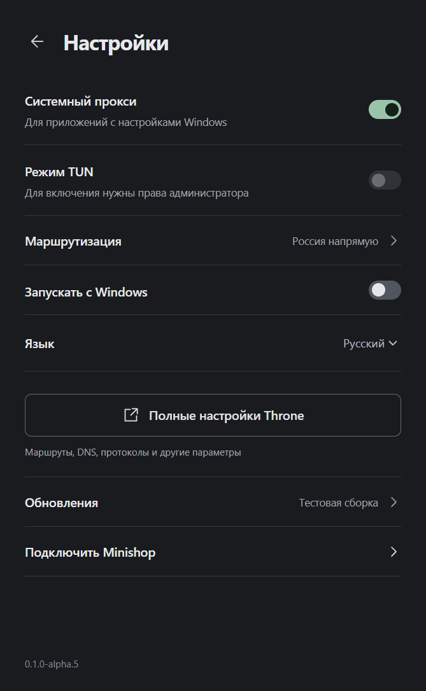

# Интерфейс alpha.5

Макет создан встроенным GPT Image 9 ноября 2026 года. В реализации используются
только сплошные цвета, без градиентов, декоративного свечения и рекламных подписей.
Изображение служит ориентиром для пропорций; интерфейс остаётся настоящими React-компонентами.

Главная страница содержит выбранный сервер, кнопку подключения, выбранную подписку
и добавление источника. Полный список серверов открывается по нажатию на строку.
Выбор сохраняется и сам по себе не включает соединение. Слоганы, постоянные сведения
об обновлении, маршрутизации и технических режимах убраны с главной.

В настройках все строки имеют действие: переключатели, выбор языка, открытие
маршрутов в штатном Throne, сведения об обновлении и управление входом в Minishop.
При входе в полные настройки соединение останавливается. После сохранения в Throne
можно нажать «Вернуться в Mini Throne»; выход через собственное меню Throne тоже
возвращает управление оболочке. Самопроизвольного переподключения нет.

Движок и штатное окно по очереди владеют одной базой. Профили не экспортируются
в отдельную копию; новые группы, обычные настройки и изменённые маршруты сохраняются.
Начальные настройки применяются один раз. Новые источники следуют активному маршруту;
существующие группы сохраняют свои индивидуальные маршруты, которые меняются в Throne.
Для управления штатным окном на время запуска настраивается защищённый локальный API.
Поля его слушателя обновляются в SQLite только после завершения процесса. Адаптер
закреплён за схемой Throne 1.4.1 и проверяет её перед записью. Ключи не передаются
в интерфейс. При отключении API в штатных настройках нужно выйти через меню Throne.
Перезапуск с повышением прав из штатного окна отдельно не проверен; TUN требует
запуска самого Mini Throne от имени администратора.

## Prompt

Create a high fidelity, implementable Windows desktop VPN client UI screenshot concept, two application windows side by side on a plain solid gray canvas. This is a PRODUCT UI screenshot, no illustration, no perspective, no device mockup. Each window is approximately 440 by 640 CSS pixels, title bar with standard minimize/maximize/close buttons. Russian interface. App name exactly "Mini Throne". Professional restrained utility software aesthetic inspired by well designed native Windows tools. Flat charcoal background #191B1E, slightly lighter surfaces #22252A, thin #35383E separators, off white #E8E9EB text and muted gray #93979F secondary text. A single muted sage green accent #9AC4AA. Segoe UI typography. Absolutely NO gradients anywhere, NO glows, NO glassmorphism, NO shadows except a thin native window outline, NO luminous power orb, NO concentric rings, NO decorative blobs, NO marketing slogans, NO fake metrics, NO rounded card dashboard, NO decorative badges. Small 6px corner radii, disciplined spacing, legible crisp typography.
LEFT WINDOW is the minimal main page. Header reads "Mini Throne" at top left and a small outlined gear icon button at top right. Beneath: a small gray status dot and clear heading "Не подключено", a plain one-line caption "Выберите сервер и подключитесь". One horizontal functional row labeled "Сервер", value "Нидерланды", a small simple Netherlands flag and a chevron showing this opens a selector. Below a plain rectangular sage green full width button, label "Подключить" with small conventional power symbol at left. Below it a thin separator and a clickable row labeled "Подписка", value "Мои серверы", chevron. Bottom a small plain text button with plus icon "Добавить подписку или сервер". The rest is deliberate empty space. Nothing else: no routing badges, no system proxy or TUN controls, no update footer, no logos, no version, no ads.
RIGHT WINDOW is Settings opened by the gear. Header back arrow and "Настройки". Compact rows separated by thin lines. "Системный прокси" switch on with secondary text "Для приложений с настройками Windows". "Режим TUN" switch off with secondary text "Для всех приложений · нужны права администратора". Clickable row "Маршрутизация" with value "Россия напрямую" and chevron. "Запускать с Windows" switch off. "Язык" value "Русский" and chevron. Then a separated full width OUTLINED rectangular button labeled exactly "Полные настройки Throne" with small external-window icon. Below its explanatory gray text: "Маршруты, DNS, протоколы и другие параметры". A compact clickable row "Обновления" value "Тестовая сборка" and chevron, and subdued version "0.1.0-alpha.5" at bottom. All elements correspond to real actions. Switches conventional, labels accurately spelled. No additional UI elements. Beautiful through proportions and typography only. Output is one composite screenshot of these TWO screens.
