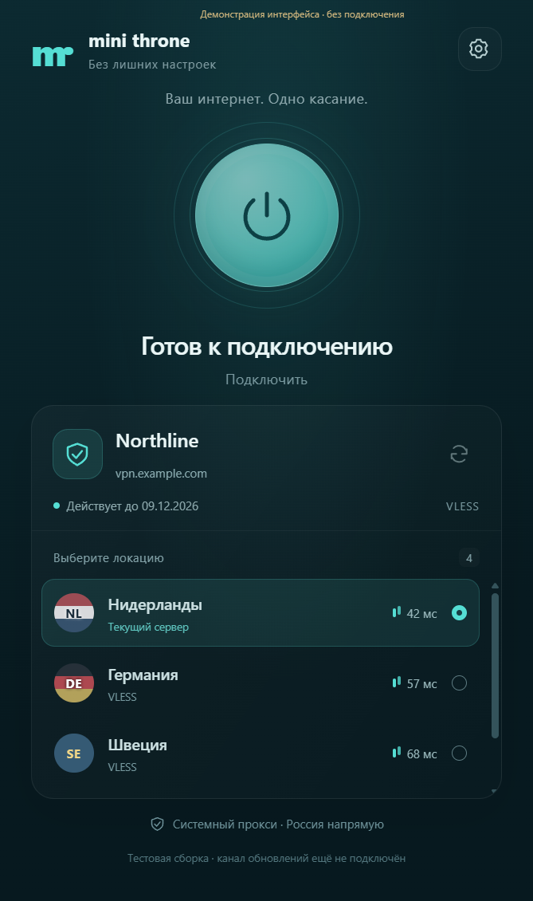

# Mini Throne: исследование и первая итерация

9 ноября 2026 года · **0.1.0-alpha.2 · Windows x64**

## Результат и выбранная основа

Создан независимый приватный форк с историей Throne 1.4.1. Новый интерфейс находится
в `desktop/`, плагин — в `minishop-plugin/`. Сетевой движок взят из официального
Windows-релиза без изменений и закреплён по SHA-256. Его соответствующие исходники
и сборочные файлы сохранены в корне, upstream commit:
`3bbe551d1ca744ad2325b9867160e123ea2b10b9`.

Репозитории: [GitLab](https://gitlab.com/3252a8/mini-throne),
[GitHub](https://github.com/3252a8/mini-throne). Рабочая ветка — `dev`.

| Исследованный проект | Что полезно | Решение |
|---|---|---|
| Throne 1.4.1 | Qt, существующие движки, широкий импорт, подписки, маршрутизация, режим без окна и защищённый API | Основа первого клиента; сохраняем совместимость сетевой части |
| throned 1.5.2 | Удобные маршруты, выбор приложений, диагностика доступности сайтов, улучшения TUN/DNS, темы и сведения о подписке | Источник отдельных улучшений для следующих итераций; не совмещаем два изменённых основания сразу |
| Archi Helper | React/Electron, NSIS, разностное обновление, ожидание окончания работы, отдельное применение | Используем подход; его код, ресурсы, профили и конфигурация не переносились |
| Happ, референс пользователя | Кнопка подключения, карточка сервиса, список локаций, минимум управления | Собственный интерфейс с такой же простотой сценария |

Throne API передаёт JSON по TCP с HMAC-SHA256 и ChaCha20-Poly1305. Это не открытый
HTTP-порт. Ключи направлений и счётчики защищают сообщения от подделки и повторов.
Адаптер mini-throne проверен на опубликованных векторах и настоящем движке.
API слушает только loopback; каталог данных и порты изолированы от обычного Throne.
Источники: [Throne](https://github.com/throneproj/Throne),
[throned](https://github.com/troshkindm/throned),
[протокол](https://github.com/throneproj/Throne-api/blob/main/spec/protocol.md),
[API](https://github.com/throneproj/Throne-api/blob/main/spec/api.md).

## Сценарии пользователя

### Подготовленный установщик из инструкции Minishop

1. В инструкции установки пользователь нажимает кнопку Mini Throne.
2. Плагин отдаёт готовый EXE с персональным именем через `Content-Disposition`.
3. Пользователь запускает скачанный EXE. Установка выполняется
   для текущего пользователя, без обязательного административного доступа.
4. При первом запуске клиент обменивает билет на свою сессию, получает цвета,
   логотип и подписку. Затем пользователь выбирает сервер и подключается.

Билет действует **30 минут** и атомарно погашается один раз. Он не содержит пароль
или постоянный адрес подписки. Повторный запуск установщика не заменяет существующий
вход. Если билет использован или истёк, доступен вход через браузер. Персональный
EXE нельзя передавать другим людям до погашения билета.

Это **один EXE без архива**, одинаковый побайтово для всех. Сервер не собирает,
не переподписывает и не копирует установщик. Меняется только имя скачиваемого файла:
`Mini-Throne-Setup--mt1.<origin-base64url>.<one-time-ticket>.exe`.
NSIS читает исходное имя через `$EXEFILE`; приложение проверяет адрес и обменивает
256-битный случайный билет на сессию. Адрес нужен для работы с независимыми инстансами
без общего сервиса-посредника. [Документация NSIS](https://nsis.sourceforge.io/Docs/Chapter4.html#varconstant).

Имя файла видно в истории загрузок и может попасть в диагностику ОС. Поэтому в нём
только краткоживущий билет, никогда пароль, refresh token или ссылка подписки.
После первого погашения билет бесполезен на любом компьютере. EXE сохраняет свою
цифровую подпись при переименовании, когда такая подпись будет настроена.
Суффикс браузера ` (1)` поддерживается. При ручном переименовании, истечении билета
или чрезмерно длинном адресе доступен обычный вход через браузер. Персональное имя
ограничено 180 символами; для более длинного адреса выдаётся обычный EXE.

Выдача персонального EXE включается после размещения готового EXE на сервере Minishop и
настройки его пути и SHA-256. Большой EXE не включён в ZIP плагина; сервер не
скачивает установщик по произвольному пользовательскому адресу. SHA-256 проверяется
при первом скачивании и после смены файла/digest, затем файл передаётся напрямую с
поддержкой Range. Временные ZIP, копии EXE и компиляторы на сервере не требуются.
Персональный ответ не кешируется браузером или общим прокси.

### Клиент уже установлен

Кнопка в инструкции открывает `mini-throne://connect?instance=…` и подставляет сервис.
Пользователь запускает вход, авторизуется обычным способом в браузере и подтверждает
совпадающий код. Пароль не передаётся клиенту. Используется device flow с S256 PKCE,
сроком запроса 5 минут и одноразовым погашением. Между инстансами нет общих
административных токенов.

### Повседневная работа

Главный экран: большая кнопка, название сервиса, срок подписки и локации. Настройки:
системный прокси, автозапуск, язык и выход. Обновление подписки и оформления — при
запуске, по кнопке и каждый час. При смене ссылки подписки сохраняется выбранная
локация, если она осталась в списке. Доступ компьютера можно отозвать в кабинете.

## Реализованные компоненты

- React-интерфейс на русском и английском, трей, адаптивный список, автозапуск Windows.
- Управление настоящим Throne: импорт и обновление подписок, серверы, подключение.
- Системный прокси включён в настройках по умолчанию и применяется после запуска
  соединения. Отдельный Windows-компонент восстанавливает предыдущие параметры
  при отключении, закрытии или сбое клиента/движка. При следующем запуске есть
  восстановление после аварийного выключения ОС.
- Bypass Russia: локальные адреса, `.ru`, `.su`, `.рф`, `geoip-ru` и
  `geosite-category-ru` — напрямую; остальное — через сервер.
  Проверенные бинарные списки и их JSON-исходники включены в сборку: первому
  подключению не нужна доступность внешнего CDN. Списки обновляются вместе с приложением.
- Device flow, access token на 15 минут, ротация refresh token, отзыв, до десяти
  сессий пользователя, проверки актуального права на подписку.
- Токены защищены Windows DPAPI; не передаются в интерфейс, deep links и журналы.
  База движка изолирована в AppData и использует обычный формат хранения Throne.
- Название, основной цвет и растровый логотип сервиса; без загрузки его JavaScript/CSS.
- Подписанный Ed25519 ZIP-плагин, блок инструкции, управление компьютерами,
  одноразовые персональные установочные пакеты.

## Обновления и производительность

Использованы `electron-updater` и NSIS с `differentialPackage`: blockmap позволяет
скачивать изменённые блоки. После загрузки проверяется целостность EXE. Проверка
запускается при старте; применение откладывается при активном соединении. Перед
перезапуском восстанавливается прокси и останавливается движок. Источник обновлений
фиксируется издателем при сборке, а не приходит от стороннего Minishop.
[Документация](https://www.electron.build/v26/docs/features/auto-update/),
[NSIS](https://www.electron.build/v26/docs/nsis/).

**В alpha автообновление не активировано:** ещё нет общедоступного HTTPS-канала и
сертификата Authenticode. Это явно отображается в клиенте. Встраивать PAT приватного
репозитория в приложение нельзя. Перед включением канала нужны две подписанные
сборки и проверка реальной разностной загрузки, её прерывания, применения и перезапуска.
Наличие реализации не является доказательством такого прогона.

Electron позволяет быстро сделать качественный интерфейс и использовать готовый
обновлятор, но увеличивает расход памяти и размер относительно чистого Qt. Установщик
этой alpha — около **152 МиБ**, исходный Windows ZIP Throne — около **55 МиБ**;
форматы упаковки различаются. Обещать одинаковый расход памяти нельзя.
Сетевой трафик проходит через исходный движок, не через React/Node. Скорость,
задержки, сон/пробуждение и длительную работу ещё нужно сравнить на реальной подписке.
Если оболочка окажется слишком тяжёлой, следующий кандидат — Qt/QML над тем же API.

## Границы первой версии

- Windows x64, пока без Authenticode. Это сборка для контролируемого теста.
- Системный прокси не обеспечивает полного VPN-покрытия: программы, игнорирующие
  настройки Windows, и произвольный UDP могут идти напрямую. TUN и kill switch
  не включены в простой пользовательский сценарий этой версии.
- Переносится основной цвет и PNG/JPEG/WebP-логотип. SVG и полный перенос темы
  отложены; неподходящий логотип заменяется значком.
- Плагин закреплён за Core `67357d3cfad4a430bfd66fbb507ddad390e5eb73`, Python 3.12,
  Linux x86_64. Поддержка любого совместимого инстанса есть на уровне протокола;
  совместимость со всеми историческими версиями Minishop не обещается.
- Core, PRO и Cloud не изменялись и не развёртывались. Их широкие продуктовые
  проверки пропущены: изменения изолированы в новом репозитории.
- Реальный вход, оформление вашего сервиса и выдача персонального установщика
  через его прокси проверяются после установки плагина на тестовый инстанс.

Инструкция: [installation.md](installation.md). Проверки: [validation.md](validation.md).

## Лицензия и следующий шаг

Throne имеет GPL-3.0. Приватность репозитория не меняет лицензию: получателям бинарников
нужно предоставить соответствующие исходники и уведомления. Внутренняя приватная
разработка допустима. [Разъяснение GNU](https://www.gnu.org/licenses/gpl-faq.html.en#GPLRequireSourcePostedPublic).
К сборке подготавливается архив исходников форка без приватного кода Core/PRO/Cloud.

Следующие приоритеты: реальный вход и персональная установка; проверка транспорта
на стенде; сертификат и канал обновлений; измерения ресурсов. Затем — автовыбор
сервера, диагностика и при необходимости TUN. Улучшения throned следует переносить
отдельными рассмотренными изменениями, сохраняя авторство и проверяя каждое.
