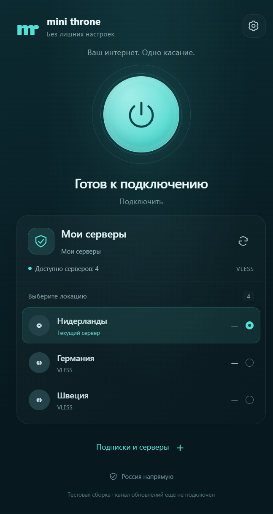
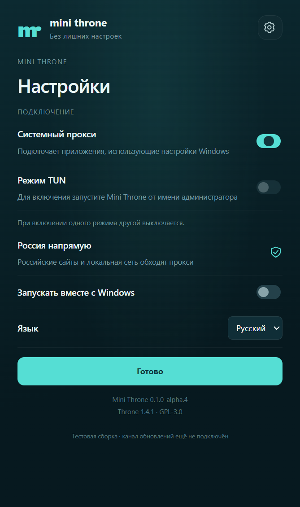
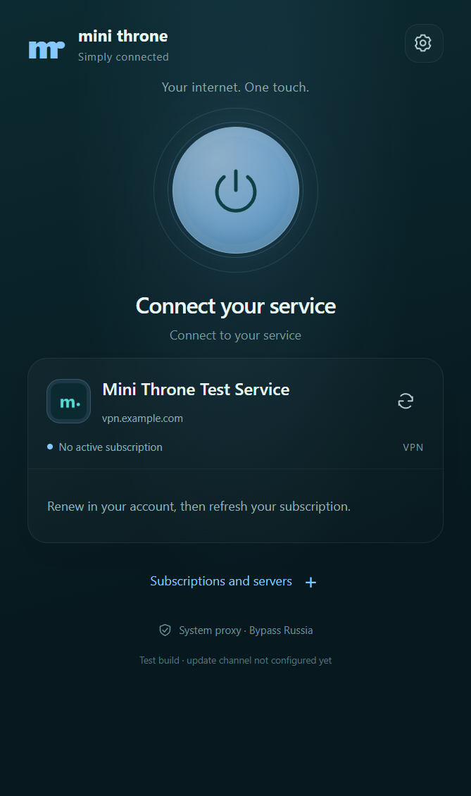

# Проверки Mini Throne

## 0.1.0-alpha.4: настройки системного прокси и TUN

Проверено 9 ноября 2026 года на Windows x64:

- `npm run check`, `npm run build`, `npm run check:runtime`: exit 0.
- NSIS EXE alpha.4 и blockmap собраны с локальной копией Electron: exit 0.
  Установленный пользовательский alpha.3 в этом прогоне не заменялся.
- Настоящий Electron и Throne запущены с отдельными данными. На главном экране
  нет переключателей системного прокси/TUN, оба доступны через шестерёнку.
- Системный прокси включён по умолчанию. Переключение и сохранение после
  перезапуска проверены через интерфейс. Одновременное включение двух режимов
  отклоняется. Управление также проверено на английском языке.
- При обычном запуске TUN недоступен, интерфейс объясняет необходимость прав
  администратора. Попытка включить его через IPC отклонена; настоящий API Throne
  также вернул `needs_privileges`, режим остался выключенным.
- Экран настроек помещается в окно без прокрутки: ширина 446, высота содержимого
  и видимой области 753 CSS px. Ошибок renderer нет.
- Регрессия движка: 8 корректных и 9 повреждённых/повторных кадров протокола,
  импорт четырёх типов серверов, подписка и её обновление, сохранение групп,
  реальный HTTP-запрос через импортированный прокси, откат ошибочного импорта.

Граница проверки: TUN с повышенными правами и изменение маршрутов всей Windows
не запускались. Проверены доступность, безопасный отказ и выключение режима;
полный сетевой прогон TUN остаётся отдельной проверкой. Плагин alpha.2 не менялся.
Матрицы Core/PRO/Cloud пропущены, поскольку их исходники и контракты не изменены.

## 0.1.0-alpha.3: установленное приложение и первый вход

Проверено 9 ноября 2026 года на настоящем Windows x64 установщике.

Обнаружена и исправлена ошибка alpha.1/alpha.2: Electron 45.2.3 не предоставляет
`chacha20-poly1305` в `node:crypto`. Поэтому проверки транспорта в обычном Node
проходили, а приложение не завершало запуск движка. Контрольный канал теперь
использует закреплённый `@noble/ciphers` 2.4.0 с тем же протоколом. VPN-трафик
по-прежнему обрабатывает исходный Throne.

- `npm run check`, `npm run build`, `npm run check:runtime`: exit 0. Новая проверка
  запускается внутри Electron, проверяет восемь официальных кадров, девять отказов
  для повреждённых/повторных кадров и готовность настоящего движка с отдельными данными.
- `npm audit --omit=dev --audit-level=high`: exit 0, production-уязвимостей нет.
- Упаковка NSIS с локальной копией Electron: exit 0; EXE и blockmap готовы.
- Настоящий EXE установлен и переустановлен без ошибок. `$EXEFILE` сохранил
  персональное имя сервера вместе с браузерным суффиксом ` (1)`; файл билета
  записан корректно. Это заменяет недоступный запуск вспомогательного EXE.
- Установленный клиент: `ready=true`, `demo=false`, настоящий движок готов,
  ошибок renderer нет, системный прокси включён в настройках по умолчанию.
- Первый запуск: реальное одноразовое погашение и выдача сессии плагином с Redis,
  сохранение токенов Windows DPAPI, получение цвета и PNG-логотипа. Локальный
  билет удалён; повторное погашение возвращает 410.
- Повторная установка сохранила зашифрованный аккаунт побайтово, не создала новый
  билет и не выполнила второй вход. Повторный запуск использовал прежнюю сессию;
  выход из интерфейса отозвал её и удалил локальный аккаунт.
- Параметры системного прокси до и после проверки совпали. Тестовые контейнеры
  остановлены; пользовательский Throne и его соединение не изменялись.

### Самостоятельные подписки и серверы

`npm run check:runtime` дополнительно проверяет настоящий импорт HTTP, VLESS,
Trojan и Shadowsocks, загрузку обычной подписки, её обновление и сохранение обеих
групп после перезапуска движка. Через импортированный HTTP-прокси прошёл реальный
HTTP-запрос к изолированному ответчику; системный прокси в тесте выключен явно.
Некорректный импорт отклонён, созданная промежуточная группа удалена.

Проверка интерфейса Electron на отдельных данных: добавление сервера без Minishop,
подключение/отключение, добавление и ручное обновление подписки, сохранение источников
и выбора после перезапуска приложения, удаление источника с подтверждением — exit 0.
Проверки типов и сборка после изменений интерфейса также завершились с exit 0.
В установленном EXE дополнительно проверено сосуществование с Minishop: после
выхода из сервиса ручной источник и его серверы остаются доступными.

Граница стенда: реальны EXE/NSIS, установленное приложение, Throne, Redis, код
выдачи/проверки/отзыва сессий плагина и DPAPI. Пользователь и данные подписки
синтетические; `bootstrap` возвращает тестовое оформление и неактивную подписку.
Только в памяти тестового процесса запросы `https://vpn.example.com` направлены
на изолированный HTTP-стенд на loopback. Файлы приложения, DNS/TLS-проверки продукта
и настройки Windows не ослаблялись. Производственный HTTPS, активная подписка
вашего Minishop, её транспорт и обновления между подписанными EXE этим прогоном
не подтверждены. Плагин alpha.2 совместим с клиентом alpha.3 и не менялся.

Полные матрицы Core/PRO/Cloud не запускались: их исходники не менялись.

## 0.1.0-alpha.2: один EXE с билетом в имени

Проверено локально 9 ноября 2026 года:

- `npm run check` и `npm run build`: exit 0.
- `npx electron-builder --win nsis --x64 --publish never --config.electronDist=node_modules/electron/dist`:
  exit 0; получены NSIS EXE и blockmap. Обычная упаковка сначала получила HTTP 504
  при загрузке Electron; использована уже установленная копия той же версии.
- `ruff check` и `ruff format --check` для Python-кода: exit 0.
- Реальный HTTP-ответ плагина в изолированном aiohttp: SHA-256 всего выданного EXE
  совпадает с исходным; `Content-Disposition` содержит персональное имя; Range
  возвращает 206 и правильный диапазон. Повторная выдача не пересчитывает digest;
  изменение ожидаемого SHA-256 отклоняется. Другой пользователь не получает файл.
- Одноразовый Redis: два конкурентных погашения дают ровно один успех и один 410;
  срок билета не превышает 1800 секунд. В тесте адаптер пользователя/выдачи сессии
  синтетический; браузерная авторизация Core не подменяется в поставляемом плагине.
- Клиент: разбор имени и суффикса ` (1)`, отказ от небезопасного адреса, однократное
  чтение, удаление локального билета и сохранение уже существующего входа.
- Chromium с настоящим frontend-модулем плагина: кнопка скачивает файл с именем
  из заголовка сервера; старое имя ZIP больше не подставляется.
- Подписанный пакет alpha.2 принят инспектором Core: проверены состав, хеши,
  Ed25519 и доверие издателю только в одноразовом каталоге.

Запуск отдельного вспомогательного EXE для проверки NSIS-макроса автоматически
отклонён проверкой безопасности среды без уточнения причины. Он не выполнялся;
компиляция настоящего установщика успешна. Фактическая установка персонального
EXE и вход на живом Minishop остаются непроверенными. Полные матрицы Core/PRO/Cloud
не запускались: их исходники не менялись. Движок и сетевые настройки в alpha.2
не менялись; повторные транспортные проверки не требовались.

## История: 0.1.0-alpha.1

Проверено локально 9 ноября 2026 года, Windows x64, Node 24.22.2.

| Проверка | Результат |
|---|---|
| `npm run check` | TypeScript: exit 0 |
| `npm run package` | Vite, native C# helper, Windows x64 NSIS EXE и blockmap: exit 0 |
| `ruff check` и `ruff format --check` для плагина и упаковщика | Exit 0 |
| `npm audit --omit=dev --audit-level=high` | Уязвимости production npm-зависимостей не обнаружены на момент запуска |
| Официальные криптографические векторы Throne API | Восемь корректных кадров, ключи направлений и отклонение некорректных кадров |
| Настоящий Throne 1.4.1 | Запуск, отдельные порты, импорт профиля, выбор маршрута и прохождение HTTP-трафика через синтетический upstream proxy |
| Bypass Russia при первом подключении | Бинарные списки из локальных файлов, без предварительного сетевого скачивания |
| Штатный установщик Core в Linux Python 3.12 | Проверка manifest, файлов, Ed25519; сначала `publisher_not_trusted`, после явного доверия в одноразовом каталоге — `trusted` |
| Redis на изолированном временном экземпляре | Единственное погашение, неверный PKCE, повторный refresh, невозможность восстановить отозванную сессию при ротации |
| Персональная упаковка | EXE внутри ZIP побайтово совпадает с проверенным EXE; билет хранится отдельным файлом |
| Electron UI | Экран сервиса, четыре синтетические локации, настройки и включённый по умолчанию системный прокси; ошибок renderer не было |

Транспортная проверка использовала документационный адрес `203.0.113.42` и локальный
синтетический proxy. Системный прокси рабочего компьютера в ней не переключался.
Это проверка действительного пути через движок, не измерение скорости реального VPN.

Тестовый Core взят свежим снимком Git-исходников, без `.env`, из commit
`67357d3cfad4a430bfd66fbb507ddad390e5eb73`. Существующий образ зависимостей использовался
только локально; приватные исходники и образы не публиковались в контейнерные реестры.
Состояние доверия издателю создавалось только во временном каталоге проверки.

Не проверялись на реальном сервисе: установка плагина и перезапуск его процессов,
вход пользователя, чтение реальной подписки, выдача большого персонального ZIP через
ingress, запуск установленного EXE с билетом, смена серверов на реальном канале,
восстановление системного прокси при принудительной гибели приложения, сон/пробуждение,
длительная работа, SVG-логотипы и применение обновления между двумя подписанными версиями.
Это явные задачи следующего теста, а не успешно пройденные проверки.

Полные матрицы Core/PRO/Cloud пропущены: их код и конфигурация не менялись.
Проверка собственного C++/Go build upstream не выполнялась: в артефакте используется
официальный бинарный релиз Throne, сверенный по закреплённому SHA-256.
Итоговые размеры и SHA-256 дистрибутивов находятся в `artifacts/SHA256SUMS.txt`.
